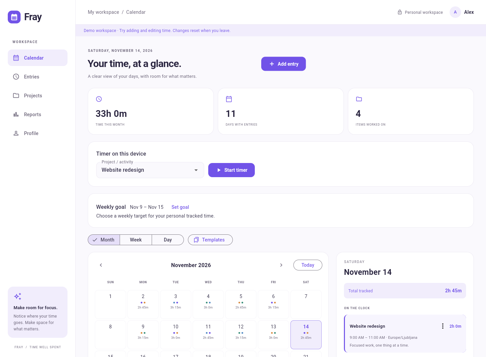
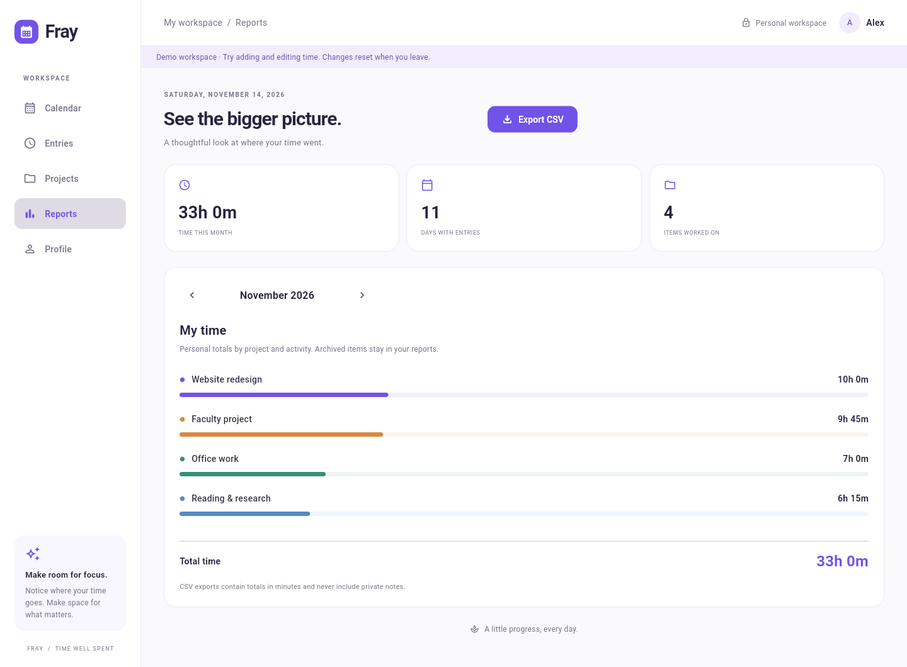
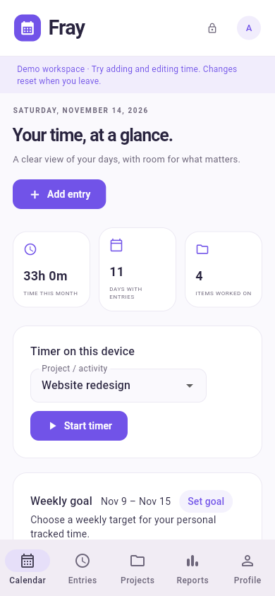

# Fray

Private time tracking for projects and recurring activities, built with **Flutter** and a **Django API**. The implementation follows the supplied purple-and-white mockups, with responsive web and Android development support. iOS scaffolding is included; iOS device validation and store publishing remain future work.

**Current scope:** a usable personal-tracking foundation. Vagrant and cloud-init are **future deployment work**, as agreed; their folders document that plan and do not provision VMs yet. The separate **Docker + Cloudflare Tunnel** deployment lives in [infra/docker](infra/docker/README.md), configured for `frayapi.klanija.com`. This is not a finished faculty submission or a production release.

For your Gitea image registry and Portainer workflow, start with [the Portainer deployment guide](infra/docker/PORTAINER.md). It includes the ready-to-paste stack, private environment generation, Cloudflare routing, account creation, and Android phone installation.



## Try it locally

Prerequisites: Flutter **3.47.9 / Dart 3.13.7**, Python **3.12+** with venv support. Development was checked with Python 3.14.9. No VM, Docker, PostgreSQL, or Redis is needed for this local setup.

From the repository root:

```sh
python3 -m venv .venv
.venv/bin/pip install -r backend/requirements.txt
cd apps/fray
flutter pub get
flutter build web --no-web-resources-cdn
cd ../..
python3 scripts/dev.py
```

Open **http://localhost:8080**, then choose **Explore the demo**. The demo uses synthetic data in memory; it does not authenticate with the backend or access any account. Demo changes disappear on refresh or exit.

If the ports are busy:

```sh
python3 scripts/dev.py --port 8787 --backend-port 8788
```

The launcher applies migrations, starts Django, serves the Flutter build, and proxies API requests on the same origin. Ctrl+C stops both servers. It binds to loopback and intentionally uses development settings; do not expose this launcher to a network. Backend edits require restarting it. Flutter edits require rebuilding the web bundle.

For Flutter hot reload / UI-only work:

```sh
cd apps/fray
flutter run -d chrome --dart-define=FRAY_DEMO=true
```

### Use a real local account

You can now select **Create an account** in the app. The local development launcher prints the verification email to its terminal instead of sending it. Enter that code, set up your authenticator using the QR code or manual key, and save the recovery codes. Production signup requires [Mailjet SMTP configuration](infra/docker/PORTAINER.md#4-enable-self-service-signup-with-mailjet). Login asks for email/password first, then the security code.

The launcher creates the local schema. Alternatively run migrations first:

```sh
FRAY_DEBUG=1 .venv/bin/python backend/manage.py migrate
mkdir -p .artifacts
FRAY_DEBUG=1 .venv/bin/python backend/manage.py create_fray_user you@example.org \
  --name Alex --output .artifacts/local-account.json
FRAY_DEBUG=1 .venv/bin/python backend/manage.py seed_demo you@example.org
```

The account command prompts for a password of at least 12 characters. It creates an authenticator seed and eight single-use recovery codes in a new file with `0600` permissions. Read that file locally, add `authenticator_secret` manually to your authenticator app as a time-based, six-digit, 30-second code, and keep the recovery codes private. Sign in using email, password, and your authenticator code. The sample-data command is optional and can be rerun without duplicating its entries.

The credentials file also contains the password for initial handoff; delete it after storing your recovery codes securely. Never include it in screenshots or submissions. `.artifacts/`, databases, and environment files are ignored by Git. The account command refuses to overwrite an existing account or credentials file.

Real account data persists in `backend/db.sqlite3`. In development only, MFA encryption derives from the local development key; use synthetic data here. Production configuration requires an independent encryption key and signing secret, PostgreSQL, Redis, and HTTPS.

## What works

- Responsive calendar with month navigation, selected-day details, and separate unscheduled time.
- Project/activity creation and editing, descriptions, colors, search, type filters, favorites, archive/unarchive.
- Timed entries, overnight intervals, duration-only entries, private notes, editing, and deletion.
- Monthly personal totals and CSV download on web; native CSV export copies text to the clipboard.
- Password + TOTP authentication, encrypted MFA seeds, replay prevention, hashed single-use recovery codes, login throttling, CSRF protection, and server-side sessions.
- Self-service signup with email verification, authenticator enrollment, and recovery-code handoff; separate password and MFA sign-in screens.
- Owner-scoped queries and reports. Knowing someone else's UUID does not grant access.
- Database constraints and migrations; an idempotent sample-data command.
- Health endpoint, Prometheus-format request/latency metrics, and audit logs without passwords, OTP codes, or notes.

The time editor uses calendar/clock pickers, regional date formats, and the device’s 12/24-hour setting. New entries use the device’s IANA timezone; existing entries retain their recorded timezone and date. The calendar also follows the locale’s first weekday. Nonexistent DST times are rejected; repeated times ask which occurrence you mean. The interface supports English, Slovenian and Croatian, including authentication, editors, reports and validation messages. Choose a language and Light, Dark or System appearance from the settings button on sign-in or from Profile. Both preferences persist on each device/browser; System follows supported device languages (otherwise English) and live OS appearance changes. Dates follow the selected language and times retain the device’s 12/24-hour preference. User-created names, descriptions and notes are never translated. Duration-only records retain a date without inventing timestamps. Timed overlaps are rejected; adjacent intervals are allowed. Timed records spanning midnight belong to their start date. Entries must last 1 minute to 24 hours.



<details>
<summary>Phone layout</summary>



</details>

## Repository

```text
apps/fray/                 Flutter source and Android/iOS/web platform projects
backend/fray/              Django configuration and routes
backend/tracker/           Models, migrations, API, account commands, tests
scripts/dev.py             Local same-origin launcher
scripts/browser-check.mjs  Optional Chromium check and screenshot capture
infra/docker/              Self-hosted Docker stack, tunnel guide, backup/restore tools
infra/vagrant/             Future Vagrant implementation notes
infra/cloud-init/          Future cloud-init implementation notes
docs/product-blueprint.md  Original product requirements, with implementation update
docs/architecture.md       Current architecture, API contract, permission boundaries
docs/faculty-project.md    Future VM stack and assignment/defense checklist
docs/validation.md         What was actually tested and remaining gaps
```

## Checks

```sh
FRAY_DEBUG=1 .venv/bin/python backend/manage.py test tracker
FRAY_DEBUG=1 .venv/bin/python backend/manage.py makemigrations --check --dry-run
cd apps/fray
flutter analyze
flutter test
flutter build web --no-web-resources-cdn
```

Optional browser check, with the local launcher already running:

```sh
npm install --prefix .artifacts/browser playwright
.artifacts/browser/node_modules/.bin/playwright install chromium
FRAY_PLAYWRIGHT_PATH="$PWD/.artifacts/browser/node_modules/playwright" \
  node scripts/browser-check.mjs
```

Set `FRAY_BROWSER_AUTH=1` to also create a temporary local account, verify MFA recovery-code login and persistent writes through the UI, and remove that account afterward. Run this against a disposable local development database. The optional Docker mode and Android device check are described in [the validation record](docs/validation.md).

Set `FRAY_BROWSER_URL` for a different port and `PLAYWRIGHT_CHROMIUM_EXECUTABLE` to use an installed Chromium. Screenshots show synthetic demo data; they are app usage evidence, not VM deployment evidence.

## Next milestones

1. Self-service password reset, MFA rotation, and reauthentication. Signup, email verification, and initial MFA enrollment are implemented; production email delivery needs configured Mailjet credentials.
2. Week/day time-grid views, pagination for large histories, broader mobile device validation, and release signing. Android now defaults to `https://frayapi.klanija.com`; native sessions persist in secure storage until server expiry. The public route must be configured on your server before real login works.
3. Collaboration: memberships, expiring invitations, aggregate reports, and explicit sharing permissions. Current projects are personal; the schema will be extended with memberships before any shared access is enabled.
4. XLSX and summary/detailed PDF exports, account export/deletion, accessibility/device review, and store-ready icons/signing. Generated platform launcher icons are still placeholders.
5. The two VM deployment variants, public HTTPS verification, concurrency/load tests, monitoring dashboards/notification delivery, faculty VM backup/restore verification, and deployment recordings. Docker self-hosting already has PostgreSQL/Redis integration, Prometheus scraping/rules, and a tested backup restore; it does not replace the assignment’s apt-based VM provisioning.

See [the faculty plan](docs/faculty-project.md) for how the app will satisfy the virtualization assignment later. The faculty organization, team ID, private repository creation, and final archive are intentionally left until that work starts.

Language catalogs, appearance settings and their tests are documented in [localization and appearance](docs/localization.md).
