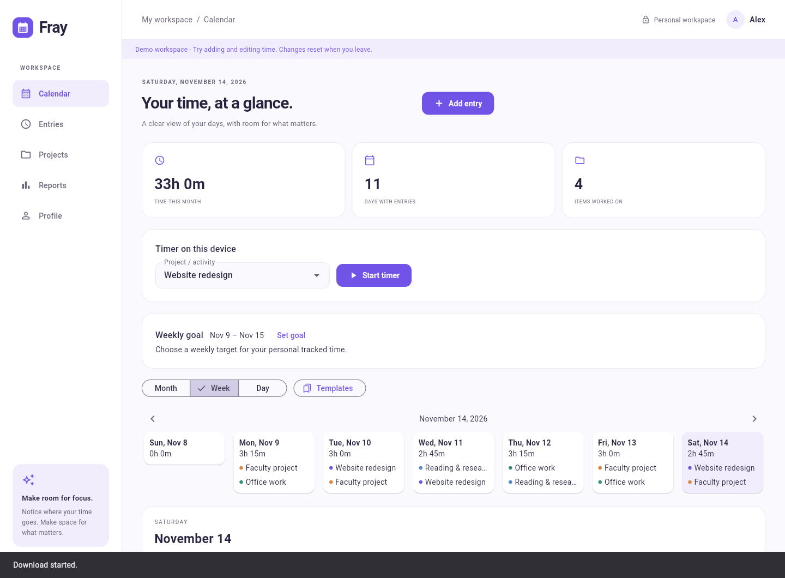
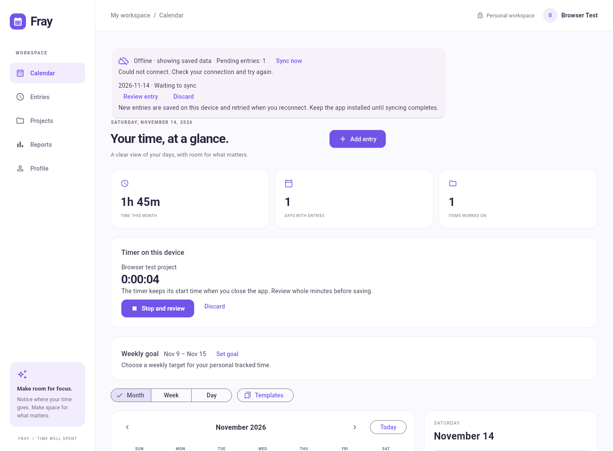
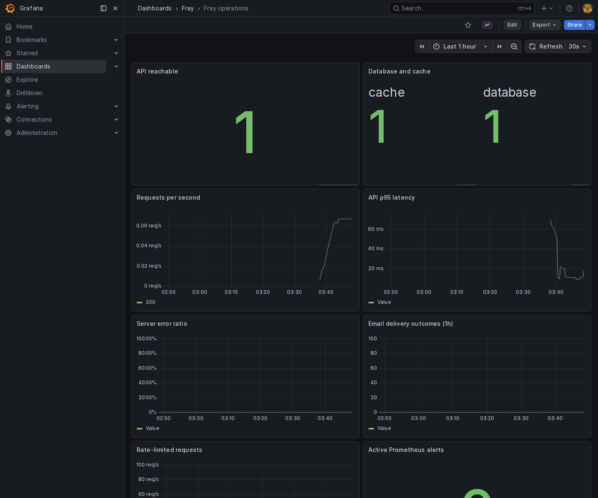

# App improvements — 0.2.0

This release adds account recovery, offline time entry, timers, reusable templates, calendar views, goals, sharing and PDF export. It retains English, Slovenian and Croatian, device clock preferences, and Light/Dark/System appearance. iOS device work is the next milestone. Vagrant and cloud-init remain deferred.

## Account and email

Sign-in still asks for password first and authenticator/recovery code second. Signup shows the resend cooldown; throttled signup/reset requests return `Retry-After` and the client shows a countdown. No operator secret or raw SMTP exception is returned to users.

**Forgot password** sends a session-bound code valid for ten minutes. Finish with the emailed code, a new password, and an authenticator or unused recovery code. Knowing an email address is insufficient. Unknown accounts and delivery failures get the same public response. Five failed code attempts exhaust the challenge; requesting another code is rate-limited. A completed reset invalidates existing sessions and also verifies the account email. SMTP response timing can still differ for existing accounts; this is not a promise of timing-resistant account enumeration.

Profile → **Account security** requires the current password and a fresh authenticator/recovery code for each sensitive action:

- Change password: keep this session, invalidate other password sessions.
- Regenerate recovery codes: replace all eight codes; save the new set before closing.
- Replace authenticator: the old device remains active until a code from the new seed is confirmed. Confirmation replaces recovery codes and invalidates other OTP-device sessions.
- Delete account: type `DELETE`; your records are permanently removed. First sync/discard local changes, stop the timer, and transfer projects that retain another person's records or members. Account deletion removes your contributed time from project aggregates. Existing private backups expire under the operator's retention policy; deletion does not rewrite old backups.

Accounts created with the operator CLI have no verified-email claim. They can verify through the password-reset flow before accepting invitations. Email verification is required on invitation acceptance even when the user is already logged in.

## Time tracking

Duration-only entries use separate **Hours** and **Minutes** fields (0–24 hours, 0–59 minutes). Empty fields count as zero; the total must remain between one minute and 24 hours. Existing entries and template drafts split their saved total into these fields. The API/database still store a single integer number of minutes.

The timer stores its UTC start and original timezone on this device. It survives app restarts and does not require an Android background service. **Stop and review** opens a timed-entry draft; cancelling keeps the timer. Saving rounds outward to whole minutes, with a minimum of one minute. Timers longer than 24 hours need separate manual entries. This is one timer per device, not a synchronized timer across devices. Demo timers remain in memory.

An entry's menu offers **Duplicate entry** and **Save as template**. Duplication uses the selected day and creates a separate record. Templates retain the project, duration and notes; using one opens an editable duration-only draft. Templates and goals are account data and require a connection to change.

Choose Month, Week or Day above the calendar. Weeks follow the selected locale's first weekday. Clicking an hour in Day opens a timed draft at that hour. Overnight records belong to their start date; their block is clipped at the bottom of the day, while the entry details preserve the full interval. The grid positions each entry by its recorded local clock; timezone labels remain visible. It is a planning overview, not a single absolute-time axis across different timezones or repeated DST hours.

Weekly goals compare **personal** minutes from Monday through Sunday with a target from 0 to 10080 minutes. Zero disables the goal. Shared totals do not count as your own progress.

## Offline data and conflict handling

After a successful login/load, an encrypted workspace snapshot is stored through `flutter_secure_storage`, separately from session cookies and scoped to the API origin/account. It contains cached entries, project labels, templates, goal, timer and pending operations. On the web this relies on browser WebCrypto/storage and HTTPS (localhost is allowed); it is not protection against scripts running in the same origin. Device access remains trusted. Logout and account deletion clear the workspace snapshot.

Loaded months are cached, bounded to twelve month keys, with extra days for cross-month weeks. An uncached month is visibly marked incomplete. The app can create/edit/delete time entries offline; other account/project operations need the server. Do not uninstall, clear app/browser storage or use an ephemeral browser profile until pending changes are synced.

Each local change is persisted **before** a request is sent. A failed device write rolls it back and shows an error. Retry happens on refresh, foreground resume, or every 30 seconds while the workspace is open and offline/pending. Sync verifies the current account first. An expired session shows **Sign in again**; another account cannot receive or overwrite queued changes. Sign-out is blocked while changes or a timer remain.

Creates carry a UUID operation ID. The server stores a receipt under a unique `(user, operation)` constraint in the same transaction as the entry. Identical retries return the original entry, even after a lost response. A deleted entry's retained receipt prevents it from being recreated. A changed retry payload becomes a conflict. Receipts have no automatic expiry in this release.

Edits/deletes include the last known revision. A newer server revision returns 409 instead of overwriting another device's work. Sync stops at the first failed operation to preserve order. **Review entry** lets you correct validation/overlap errors; **Discard** removes the local attempt and reloads server state. For a revision conflict, preserve any text you need before discarding, reload, then apply the desired change to the current record. Discarding does not undo an operation that already reached the server. Older clients that omit revisions keep their prior last-write behavior; update all devices for conflict protection.

## Shared projects

Projects → **Invitations** lists invitations addressed to the logged-in email. Owners invite by email; recipients accept/decline in the app. Invitations expire after seven days. Owners can resend/revoke, remove members and transfer ownership to an existing member. Members can leave. Activities remain personal.

| Action | Owner | Member | Former member with history |
|---|---|---|---|
| Read project name/color/description | Yes | Yes | Yes, for retained personal entries |
| Edit metadata, pin/archive, invite/remove/transfer | Yes | No | No |
| Create time on an active project | Yes | Yes | No |
| Read individual entries/notes | Own only | Own only | Own only |
| See total project minutes and member list | Yes | Yes | No |
| Delete own historical time | Yes | Yes | Yes |

The shared view contains a monthly aggregate and member names, **not** individual records or notes. A small group's total may still let members infer contributions by subtraction; share only with people you intend to see the aggregate. Removing/leaving does not erase historical contributions. Transferring ownership makes the previous owner a member and revokes outstanding invitations. A shared project with other people's history cannot be converted into a personal activity or deleted through owner account deletion.

## Exports

Reports → **Export CSV** produces project/activity totals in minutes, with spreadsheet formula escaping and no notes. On Android, CSV/PDF use the system share sheet; web downloads files. Offline/pending reports use the visible local snapshot and may include unsynced work.

**Export PDF** offers a summary or individual-entry report. Detailed reports include dates, recorded timezones/intervals, durations and project names. Notes require an explicit checkbox and default off. PDF fonts are bundled, so export does not fetch third-party fonts. Check the incomplete-cache and pending-change indicators before sharing a report.

## Operator diagnostics

In the API container console:

```sh
python manage.py check_email
python manage.py check_email --connect
python manage.py reset_signup_limit your-correct-email@example.org
```

The first command prints only whether SMTP fields are configured. `--connect` tests connection/TLS/authentication without sending email; sender acceptance/inbox delivery still needs an actual signup. Logs and `fray_mail_deliveries_total{result}` distinguish DNS, authentication, TLS, timeout, sender/recipient and connection failures without credentials. The reset-limit command clears only the named signup email bucket; it does not disable global limits, MFA throttling or password-reset protection.

Container names ending in `-1` are normal. Compose DNS uses the service name (`api`, `db`), independent of those suffixes. The API needs its outbound `mail` network for public SMTP DNS and connections. See [Docker operations](../infra/docker/OPERATIONS.md).

## Screenshots






